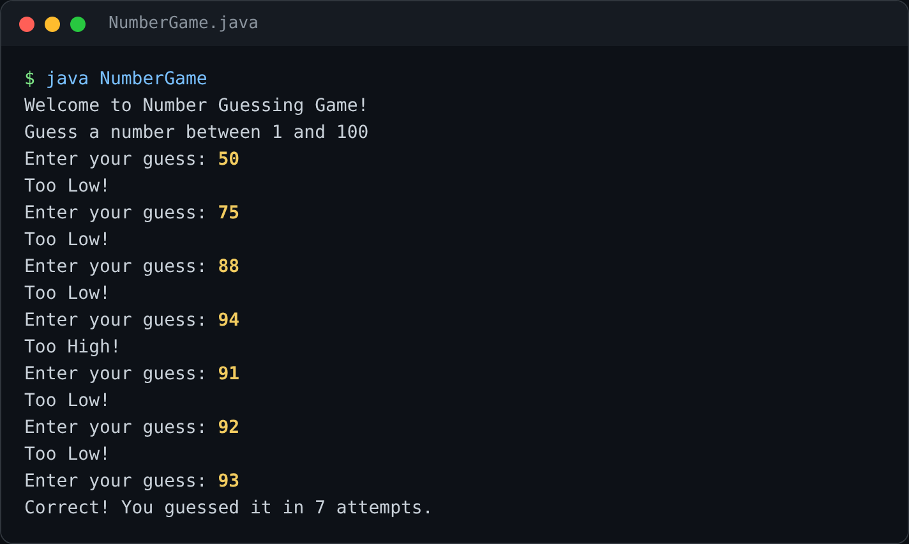
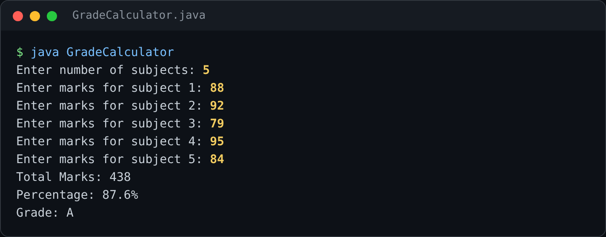
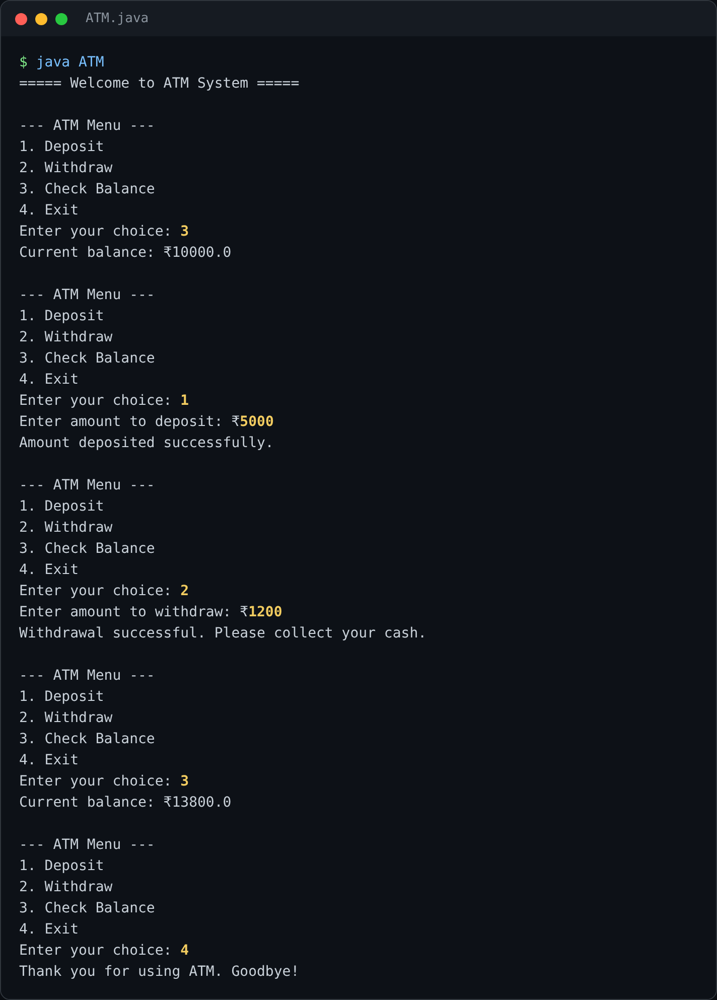

# Daily Coding Practice 🚀

This repository contains my daily coding practice to improve problem-solving skills and programming knowledge.

## 📌 Topics Covered
- Data Structures
- Algorithms
- Java Programming
- Problem Solving

## 📅 Goal
To build strong logical thinking and prepare for technical interviews.

## 🧩 Projects

| Task | What it does | Folder |
|---|---|---|
| 🎯 Number Guessing Game | Picks a random number from 1 to 100 and gives "Too High / Too Low" hints until you guess it | [Task1_NumberGame](Task1_NumberGame) |
| 📊 Student Grade Calculator | Takes marks for N subjects and calculates the total, percentage and grade | [Task2_StudentGradeCalculator](Task2_StudentGradeCalculator) |
| 🏧 ATM Interface | Menu-driven ATM with deposit, withdraw (with balance checks) and balance enquiry | [Task3_ATM_Interface](Task3_ATM_Interface) |

## ▶️ Sample Runs

**Number Guessing Game**



**Student Grade Calculator**



**ATM Interface**



## 🛠️ How to Run

```bash
cd Task1_NumberGame
javac NumberGame.java
java NumberGame
```
